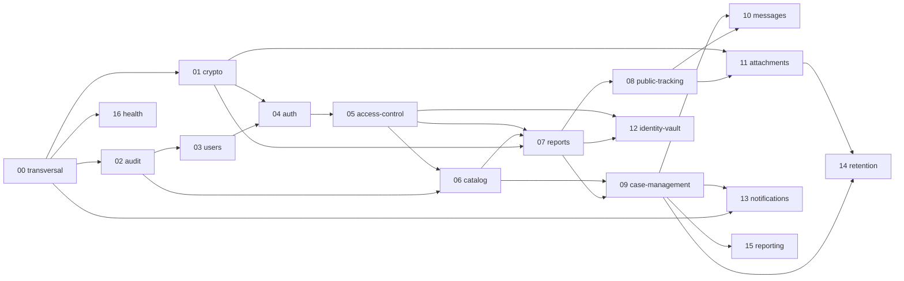

# Backlog do backend

Tarefas para implementar a API, organizadas por módulo e numeradas na ordem recomendada. As decisões que embasam
cada tarefa estão em [`docs/adr/`](../adr/README.md).

## Como ler

- Cada arquivo tem o objetivo do módulo, as dependências e as tarefas.
- Cada tarefa tem um ID (`CRYPTO-01`), estimativa, marco, endpoints, eventos de auditoria e critérios de aceite em
  checklist. Marque os itens ao concluir.
- **Estimativa relativa:** P (até 1 dia), M (2 a 3 dias), G (4 a 5 dias).
- **Marcos:**
  - **MVP:** a primeira denúncia vai do envio até a conclusão.
  - **Produção:** obrigatório antes de receber denúncias reais.
  - **Evolução:** pode vir depois da entrada em produção.

## Índice

| #   | Arquivo                                        | Módulo                     | Tarefas | MVP    | Produção | Evolução |
| --- | ---------------------------------------------- | -------------------------- | ------- | ------ | -------- | -------- |
| 00  | [00-transversal.md](00-transversal.md)         | Infraestrutura transversal | 12      | 10     | 2        | 0        |
| 01  | [01-crypto.md](01-crypto.md)                   | crypto                     | 8       | 5      | 3        | 0        |
| 02  | [02-audit.md](02-audit.md)                     | audit                      | 9       | 6      | 2        | 1        |
| 03  | [03-users.md](03-users.md)                     | users                      | 7       | 7      | 0        | 0        |
| 04  | [04-auth.md](04-auth.md)                       | auth                       | 9       | 8      | 1        | 0        |
| 05  | [05-access-control.md](05-access-control.md)   | access-control             | 6       | 6      | 0        | 0        |
| 06  | [06-catalog.md](06-catalog.md)                 | catalog                    | 4       | 3      | 1        | 0        |
| 07  | [07-reports.md](07-reports.md)                 | reports                    | 5       | 5      | 0        | 0        |
| 08  | [08-public-tracking.md](08-public-tracking.md) | public-tracking            | 4       | 3      | 1        | 0        |
| 09  | [09-case-management.md](09-case-management.md) | case-management            | 8       | 7      | 1        | 0        |
| 10  | [10-messages.md](10-messages.md)               | messages                   | 5       | 4      | 1        | 0        |
| 11  | [11-attachments.md](11-attachments.md)         | attachments                | 5       | 0      | 5        | 0        |
| 12  | [12-identity-vault.md](12-identity-vault.md)   | identity-vault             | 6       | 0      | 6        | 0        |
| 13  | [13-notifications.md](13-notifications.md)     | notifications              | 3       | 0      | 3        | 0        |
| 14  | [14-retention.md](14-retention.md)             | retention                  | 5       | 1      | 4        | 0        |
| 15  | [15-reporting.md](15-reporting.md)             | reporting                  | 3       | 0      | 2        | 1        |
| 16  | [16-health.md](16-health.md)                   | health                     | 2       | 0      | 1        | 1        |
|     |                                                | **Total**                  | **101** | **65** | **33**   | **3**    |

Estimativas: 47 P, 47 M e 7 G.

## Ordem de implementação

1. **Base:** transversal (TRV-01 a TRV-05, TRV-07, TRV-08, TRV-10, TRV-11).
2. **Fundação de segurança:** crypto e audit. Todo módulo que grava dado sensível depende dos dois.
3. **Decisões de auth:** AUTH-00 e ACL-00, antes de escrever qualquer código de login ou permissão.
4. **Equipe interna:** users, auth e access-control, mais o comando `create-admin` (TRV-09).
5. **Domínio:** catalog, reports, public-tracking, case-management e messages. Fecha o MVP.
6. **Antes da produção:** attachments, identity-vault, notifications, retention, reporting, health e as tarefas
   marcadas como Produção nos módulos anteriores.

## Dependências entre módulos

`audit` é usado por praticamente todos os módulos. No diagrama aparecem só as ligações que definem a ordem.

## Marco do MVP

O que precisa estar pronto para a primeira denúncia ir do envio até a conclusão:

1. Um ADMIN é criado pela CLI (TRV-09), entra com senha e MFA (AUTH-01 a AUTH-06) e cadastra um gestor e um
   analista (USERS-02, USERS-05).
2. O denunciante abre o formulário com as categorias (CAT-01), envia a denúncia e recebe protocolo e chave
   (REP-01, REP-02). O relato fica cifrado (CRYPTO-01 a CRYPTO-03) e o envio fica na auditoria sem IP (AUDIT-02,
   AUDIT-03).
3. O gestor vê a denúncia na caixa (REP-03, ACL-03), abre (REP-04), coloca em triagem, atribui ao analista e define a
   prioridade (CASE-01 a CASE-04).
4. O analista investiga, pede mais informações (MSG-03, `AWAITING_REPORTER`), o denunciante consulta com protocolo e
   chave e responde (PUB-01 a PUB-03, MSG-01, MSG-02).
5. O analista registra notas (CASE-06) e conclui com desfecho e justificativa (CASE-02). `retention_until` é
   calculado (RET-01).
6. O denunciante vê a denúncia como encerrada (PUB-03).

**Ficam fora do MVP:** anexos, identificação opcional do denunciante, e-mails, expurgo automático, indicadores e
métricas. Durante o MVP, o formulário não oferece identificação nem anexos.

**O MVP não vai para produção.** Antes de receber denúncias reais, todas as tarefas do marco Produção precisam estar
prontas, principalmente RET-02 (expurgo), CRYPTO-07 (políticas do Vault), TRV-12 (proxy sem log nas rotas públicas)
e AUDIT-07 (verificação da cadeia).

## Fora do escopo

- Proteção contra spam e denúncias abusivas nas rotas públicas: captcha, proof-of-work, rate limit e detecção de
  duplicatas (decisão D15).
- Cadastro ou login de quem denuncia (decisão D16).
- Multi-tenant (decisão D02).
- Contato com o denunciante por e-mail ou telefone (decisão D06).

O rate limit no login da equipe (AUTH-08) não é proteção contra spam: protege as senhas da equipe e está no escopo.

## Decisões tomadas

| Data       | Ponto                                                         | Decisão                                                                                                                                        | Tarefas                   |
| ---------- | ------------------------------------------------------------- | ---------------------------------------------------------------------------------------------------------------------------------------------- | ------------------------- |
| 27/11/2026 | O DPO lê o conteúdo da denúncia?                              | Sim, em modo somente leitura, de todas as denúncias (respeitando conflito de interesse)                                                        | ACL-01                    |
| 27/11/2026 | O ADMIN pode acumular perfis que leem denúncias?              | Sim. Em compensação, ninguém altera os próprios perfis                                                                                         | USERS-05                  |
| 27/11/2026 | O denunciante vê o desfecho?                                  | Sim: Procedente, Parcialmente procedente ou Improcedente                                                                                       | PUB-03                    |
| 27/11/2026 | O SLA fica suspenso enquanto se espera o denunciante?         | Sim                                                                                                                                            | CAT-04                    |
| 27/11/2026 | Como isolar a `identity-kek`?                                 | Serviço separado (`identity-worker`), único com credencial na chave. A API não tem acesso                                                      | CRYPTO-07, IDV-05, IDV-06 |
| 27/11/2026 | Arredondar o horário das ações do denunciante na auditoria?   | Não. O horário é gravado exato                                                                                                                 | AUDIT-02                  |
| 27/11/2026 | Prazo de retenção dos backups                                 | Indeterminado. O expurgo não alcança os backups (registrar no RIPD)                                                                            | RET-02                    |
| 28/11/2026 | Denúncias atribuídas a um analista desativado ou sem o perfil | Desativar ou retirar o perfil é recusado (409, com a quantidade) até o Gestor reatribuir. Bloquear é sempre permitido e imediato (feature 005) | USERS-04, USERS-05        |

## Pontos em aberto

| #   | Ponto                                                                                                                                                                                                               | Onde            |
| --- | ------------------------------------------------------------------------------------------------------------------------------------------------------------------------------------------------------------------- | --------------- |
| 1   | Usar os pacotes oficiais `@nestjs/authentication` e `@nestjs/authorization` ou passport, argon2, otplib e CASL. Se for o pacote oficial, o hash muda de argon2id para scrypt e a decisão D03 precisa ser atualizada | AUTH-00, ACL-00 |
| 2   | zod (Standard Schema, nativo no Nest 12) ou `class-validator` para validar entrada                                                                                                                                  | TRV-02          |
| 4   | Mudança no prazo de retenção vale só para encerramentos futuros?                                                                                                                                                    | CAT-03          |
| 5   | Prazo de guarda da própria trilha de auditoria                                                                                                                                                                      | AUDIT-09        |
| 6   | Tipos de arquivo aceitos como anexo além de PDF, PNG, JPEG e TXT                                                                                                                                                    | ATT-01          |
| 7   | Migrations novas previstas: `users.mfa_last_used_step` (AUTH-04, se o pacote escolhido não cuidar disso) e `reports.legal_hold` (RET-03)                                                                            | AUTH-04, RET-03 |
